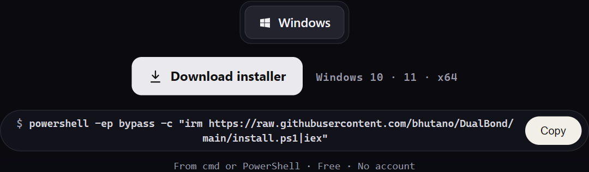
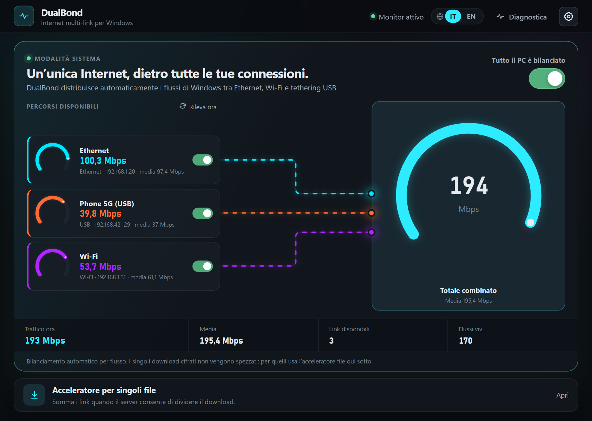
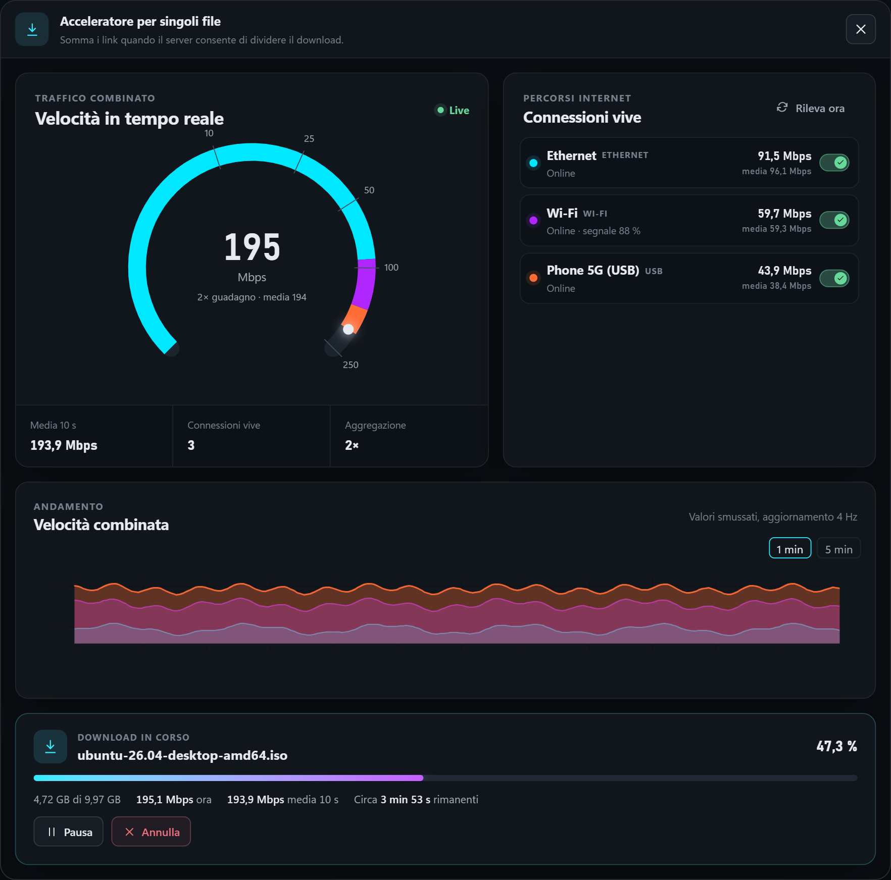
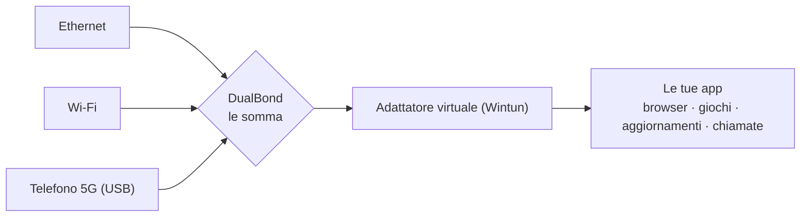

<div align="center">


# DualBond

## Tutte le tue connessioni. Sommate in una.

Collega un telefono. Unisciti a un Wi-Fi.<br>
DualBond le somma.

<br>

| 🐢 **Internet lento o instabile?** | 🚀 **Vuoi più banda?** |
|:---|:---|
| Raccogli tutte le connessioni a portata — telefoni, anche un Wi-Fi debole — e falle lavorare come una. Se una cade, le altre ti tengono online. | Cavo veloce, Wi-Fi veloce e un telefono in USB tirano tutti insieme, ben oltre quello che dà ciascuno da solo. |
| 📶 12 Mbps + 📱 25 Mbps + 📱 18 Mbps<br>**= 55 Mbps** | 🔌 1 Gbps + 📶 700 Mbps + 📱 600 Mbps<br>**= 2,3 Gbps 🚀** |

<sub>Le velocità si sommano: più connessioni aggiungi, più banda ottieni. Il risultato reale dipende da sito, router e disco.</sub>

<a href="https://github.com/bhutano/DualBond/releases/latest"></a>

```powershell
powershell -ep bypass -c "irm https://raw.githubusercontent.com/bhutano/DualBond/main/install.ps1|iex"
```

<sub>Da cmd o PowerShell — oppure clicca la scheda per scaricare l'installer.</sub>

<br><br>



<sub>Ogni connessione ha il suo piccolo quadrante; le linee tratteggiate mostrano come confluiscono in quello grande — la tua velocità totale.<br>(Illustrazione con dati simulati.)</sub>

<br>


[🇬🇧 Read in English](README.md)

</div>

---

## L'idea

Il tuo internet è lento. Oppure continua a cadere.

Ma hai un telefono a portata di mano. Magari due. Oppure un Wi-Fi vicino, anche debole, che a malapena arriva alla scrivania.

Di solito il computer ne usa **una sola** e ignora le altre.
**DualBond le usa tutte, nello stesso momento — e le velocità si sommano.**

> Un Wi-Fi debole a 12 Mbps · un telefono a 25 Mbps · un secondo telefono a 18 Mbps
> &nbsp;&nbsp;→ insieme, circa **55 Mbps**.

Nessun dispositivo speciale. Nessun account. Niente da pagare.

## Come si usa

**1 · Collega quello che hai.**
Attacca un telefono con il cavo USB e attiva la *connessione USB* (tethering) — oppure accendi il suo hotspot Wi-Fi — oppure collegati a un altro Wi-Fi. Puoi usare quanti telefoni vuoi.

**2 · Accendi l'interruttore.**
Apri DualBond e attiva l'interruttore grande.

**3 · Fine.**
Il quadrante grande mostra la velocità totale. Quelli piccoli mostrano cosa dà ogni connessione. Ne colleghi una, si aggiunge. La scolleghi, tutto continua.

## Quando serve

### 🐢 Quando internet è lento e continua a cadere
È per questo che esiste DualBond. Linea di casa debole, un appartamento in affitto, la casa delle vacanze, un campeggio, un treno, un bar con il Wi-Fi scarso.
Raccogli tutte le connessioni che hai a portata — qualche telefono, ogni Wi-Fi che riesci ad agganciare, anche debole — e falle lavorare come una sola.
Le velocità si sommano. E se una si interrompe, le altre ti tengono online.

### 🚀 Quando vuoi semplicemente più velocità
Non è solo un salvagente per internet scadente. Un cavo veloce, un Wi-Fi veloce e un telefono in USB possono lavorare insieme e andare oltre quello che fa ciascuno da solo.

> 🔌 Cavo **1 Gbps** + 📶 Wi-Fi **700 Mbps** + 📱 telefono in USB **600 Mbps** = **2,3 Gbps** 🚀

<sub>1 Gbps = 1.000 Mbps. Le velocità si sommano: più connessioni, più banda. Il risultato reale dipende da sito, router e disco.</sub>

### 📥 Quando scarichi qualcosa di grosso
Un gioco, un film, un aggiornamento di sistema, un file enorme.
DualBond lo divide in pezzi e porta ogni pezzo da una connessione diversa. Il file arriva in una frazione del tempo.

### 📞 Quando una videochiamata non deve scattare
Qualcuno scarica, qualcuno guarda un video, i backup sono in corso. Con più connessioni a dividersi il lavoro, niente disturba la tua chiamata.

### 💼 Quando lavori da un posto con internet scarso
Metti insieme quello che c'è intorno e ottieni una connessione su cui si può lavorare davvero, senza pagare un servizio speciale.

### 📱 Quando i dati del telefono sono limitati
Segna un telefono come *a consumo*. DualBond lo tratta con riguardo e lo usa solo quando serve davvero.

### 🔌 Quando una connessione non è affidabile
Se una connessione sparisce, le nuove attività passano da sole alle altre. Non devi fare niente.

<sub>**Da sapere.** Una singola pagina web o un singolo video viaggiano comunque su una connessione alla volta. Il vantaggio si vede quando succedono tante cose insieme — cioè quasi sempre — e nei download di file grandi, che DualBond divide su tutte le connessioni. La velocità reale dipende dal segnale di ogni connessione e dalla velocità del sito.</sub>

---

## Sotto il cofano

Quello che segue è per i curiosi: non serve per usare DualBond.

<div align="center">

</div>

## Come funziona



DualBond ha due modalità che collaborano.

### 1 · Modalità sistema — bilanciamento per flusso di tutto il PC

- Un servizio Windows in background crea un adattatore virtuale (Wintun) e cattura il traffico IPv4
  TCP/UDP in uscita con due route `/1` — la route predefinita fisica non viene mai toccata.
- Uno stack di rete in user-mode termina ogni nuovo flusso e sceglie un link fisico con uno scheduler
  *weighted least-connections* (salute del link, capacità osservata, costo a consumo, preferenze utente).
- Il socket in uscita è vincolato all'adattatore scelto (`IP_UNICAST_IF` + bind all'indirizzo locale):
  il traffico esce davvero da quell'interfaccia e non rientra mai nel tunnel.
- I link sono monitorati di continuo. Un link che perde l'accesso Internet *reale* (verificato con il
  Network List Manager di Windows) smette di ricevere nuovi flussi.

In questa modalità una singola connessione **non viene mai spezzata**: è ciò che mantiene TLS, QUIC e
giochi perfettamente funzionanti. La velocità aggregata si vede quando più flussi viaggiano in
parallelo, cioè quasi sempre su un PC normale.

### 2 · Acceleratore file — un download su più link

Incolla un URL HTTP(S) diretto. DualBond interroga il server (supporto `Range`, dimensione, ETag), divide
il file in blocchi e li scarica in parallelo, **ogni blocco vincolato a un link specifico**, con work
stealing e tail splitting così il link più veloce non aspetta mai il più lento. Riprende al byte dopo
pausa, crash o riavvio (stato SQLite, validazione `If-Range`) e verifica il risultato.

È la modalità che rende *un* download più veloce di qualsiasi link singolo.

## Confronto con progetti simili

| | **DualBond** | Bonding stile Speedify | OpenMPTCProuter / MPTCP | Solo Windows | aria2 / IDM |
|---|---|---|---|---|---|
| Richiede un server remoto | **No** | Sì (cloud del vendor) | Sì (un tuo VPS) | No | No |
| Aggrega un singolo flusso | Solo via blocchi Range (acceleratore file) | Sì (via server) | Sì (via server) | No | Blocchi Range, non legati ai link |
| Distribuisce molti flussi sui link | **Sì** | Sì | Sì | No (una sola route predefinita) | No |
| Lega ogni blocco/flusso a un adattatore scelto | **Sì** | Sì | Sì | No | No |
| Costo / account | Gratis, nessuno | Abbonamento | Infrastruttura propria | — | Gratis / a pagamento |

Parenti più vicini: Connectify Dispatch (load balancing locale per connessione, commerciale) e Speedify
(bonding con relay cloud). DualBond sta nel mezzo: locale come il primo, con aggregazione a blocchi per i download.

DualBond **non** è volutamente "vero bonding": senza un endpoint dall'altra parte, una singola connessione
TCP non può essere distribuita su più ISP. Ottiene gran parte del beneficio pratico — flussi paralleli,
fallback resiliente, file grandi accelerati — con zero infrastruttura.

## Limiti da conoscere

- Solo Windows 10/11 x64. La modalità sistema richiede i privilegi di amministratore in installazione
  (il servizio gira come `LocalSystem` per gestire adattatore Wintun e route).
- Solo IPv4 in modalità sistema (l'IPv6 resta sul percorso nativo).
- Un flusso resta su un solo link; l'accelerazione dei file richiede un server che rispetti le richieste `Range`.
- Leggere SSID e potenza del Wi-Fi richiede i *Servizi di localizzazione* di Windows attivi (regola di privacy di Windows).

## Installazione

Scarica `DualBond_<versione>_x64-setup.exe` dalla pagina [Releases](../../releases) ed eseguilo.
Gli hash SHA-256 sono pubblicati con ogni release.

**Un'impostazione di Windows che l'installer cambia.** Di serie Windows "riduce al minimo le
connessioni simultanee": colleghi l'Ethernet e stacca il Wi-Fi senza dirtelo. Così DualBond non avrebbe
niente da sommare, quindi l'installer imposta la policy
`HKLM\SOFTWARE\Policies\Microsoft\Windows\WcmSvc\GroupPolicy\fMinimizeConnections` a `0` (connessioni
simultanee consentite), la stessa cosa che altri strumenti di bonding chiedono di fare a mano. Il valore
precedente viene salvato e ripristinato quando disinstalli DualBond.

## Compilare dai sorgenti

Prerequisiti: Rust (toolchain MSVC), Node.js 20+, WebView2.

```powershell
. .\activate.ps1          # opzionale: CARGO_HOME locale al progetto (stile venv)
npm install
npm run tauri dev         # esecuzione
npm run tauri build       # installer NSIS
cd src-tauri; cargo test  # ~200 test unitari/di integrazione
```

Comandi CLI utili (stesso binario): `dualbond doctor` (valida il binding degli adattatori), `dualbond download-multi <URL>`.

## Note di sicurezza

- La UI parla col servizio tramite un protocollo JSON a righe su `127.0.0.1`, autenticato da un token
  casuale a 256 bit salvato in `%ProgramData%`.
- Sono ammessi solo pochi comandi fissi (stato, attiva/disattiva modalità sistema, aggiorna,
  attiva/disattiva link, imposta "a consumo"). Il servizio non accetta comandi shell, URL o percorsi di processo.
- I log non contengono token, contenuti del traffico né URL completi.
- Wintun (`wintun.dll`) è il binario ufficiale non modificato, firmato Authenticode — vedi
  [THIRD_PARTY_NOTICES.md](THIRD_PARTY_NOTICES.md).

## Struttura del progetto

```
src/            UI Svelte 5 (i18n in src/lib/i18n.svelte.ts)
src-tauri/src/  Rust: network/ (discovery, binding), download/ (scheduler, orchestrator),
                system_balance/ (servizio, Wintun, stack TCP/UDP)
docs/           note di design, specifiche e report di milestone (in italiano) + immagini
```

## Stato

Versione 1.0.0 — prima release pubblica. Roadmap e note tecniche in [`docs/`](docs) e [`TODO.md`](TODO.md).

## Licenza

DualBond ha il **codice pubblico** (*source-available*) con licenza [PolyForm Shield 1.0.0](LICENSE).

- ✅ Uso gratuito — a casa, a scuola, **al lavoro**.
- ✅ Libero di leggere, modificare e compilare per uso proprio.
- ❌ Non puoi venderlo né offrire un prodotto o servizio concorrente (anche gratuito o con altro nome) senza una [licenza commerciale](COMMERCIAL.md).

I contributi sono benvenuti con il [CLA](CLA.md) — vedi [CONTRIBUTING](CONTRIBUTING.md). Nome e logo sono tutelati da [TRADEMARK.md](TRADEMARK.md). I componenti di terze parti mantengono le proprie licenze ([THIRD_PARTY_NOTICES.md](THIRD_PARTY_NOTICES.md)).
