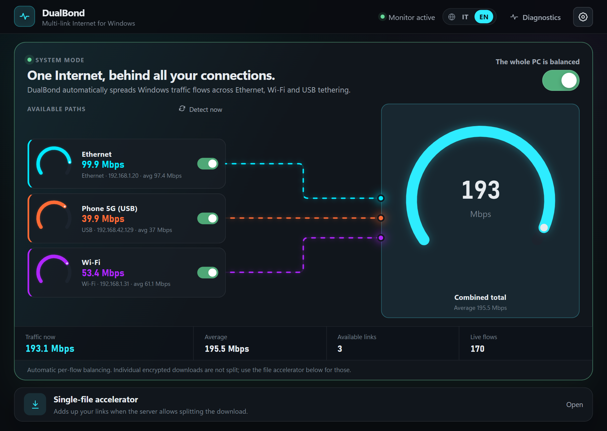
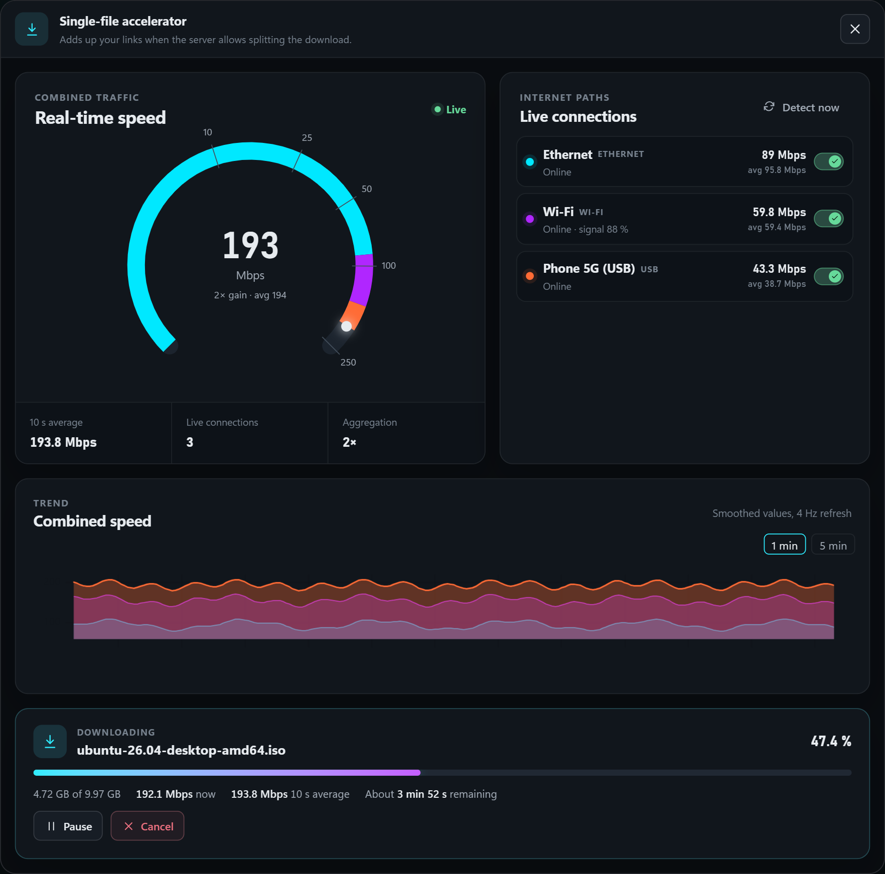
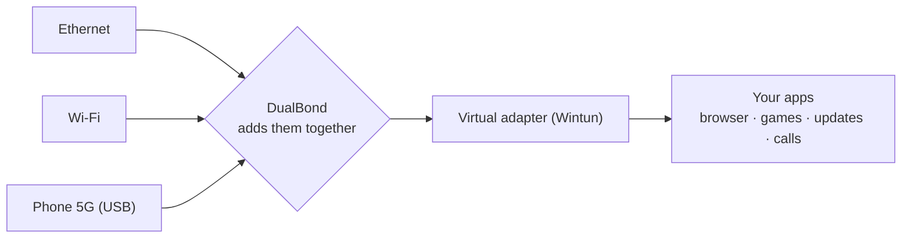

<div align="center">


# DualBond

## All your connections. Combined into one.

Plug in a phone. Join a Wi-Fi.<br>
DualBond adds them together.

<br>

| 🐢 **Slow or unstable internet?** | 🚀 **Want more bandwidth?** |
|:---|:---|
| Gather every connection within reach — phones, even a weak Wi-Fi — and let them work as one. If one drops, the others keep you online. | A fast cable, a fast Wi-Fi and a phone on USB all pull at once, well beyond what any single one delivers. |
| 📶 12 Mbps + 📱 25 Mbps + 📱 18 Mbps<br>**= 55 Mbps** | 🔌 1 Gbps + 📶 700 Mbps + 📱 600 Mbps<br>**= 2.3 Gbps 🚀** |

<sub>The speeds add up: the more connections you add, the more bandwidth you get. The real result depends on the website, your router and your disk.</sub>

<a href="https://github.com/bhutano/DualBond/releases/latest"></a>

```powershell
powershell -ep bypass -c "irm https://raw.githubusercontent.com/bhutano/DualBond/main/install.ps1|iex"
```

<sub>From cmd or PowerShell — or click the card for the installer.</sub>

<br><br>



<sub>Each connection has its own small dial; the dashed lines show them flowing into the big one — your total speed.<br>(Illustration with simulated data.)</sub>

<br>


[🇮🇹 Leggi in italiano](README.it.md)

</div>

---

## The idea

Your internet is slow. Or it keeps dropping.

But you have a phone nearby. Maybe two. Or a neighbour's Wi-Fi, a weak one, barely reaching your desk.

Your computer normally uses **just one** of them and ignores the rest.
**DualBond uses all of them, at the same time — and their speeds add up.**

> A weak Wi-Fi at 12 Mbps · a phone at 25 Mbps · a second phone at 18 Mbps
> &nbsp;&nbsp;→ together, roughly **55 Mbps**.

No special equipment. No account. Nothing to pay.

## How to use it

**1 · Connect what you have.**
Plug a phone in with a USB cable and turn on *USB tethering* — or switch on its Wi-Fi hotspot — or join another Wi-Fi. Do it with as many phones as you like.

**2 · Flip the switch.**
Open DualBond and turn on the big switch.

**3 · That's it.**
The big dial shows your total speed. The small dials show what each connection is giving you. Plug one in, it joins. Unplug it, everything carries on.

## When it helps

### 🐢 When your internet is slow and keeps dropping
This is what DualBond is made for. Weak home line, a rented flat, a holiday house, a campsite, a train, a café with poor Wi-Fi.
Gather every connection within reach — a few phones, any Wi-Fi you can catch, even a weak one — and let them work as one.
Speeds add up. And when one of them cuts out, the others keep you online.

### 🚀 When you simply want more speed
It isn't only a rescue for bad internet. A fast cable, a fast Wi-Fi and a phone on USB can all work together and go past what any one of them can do.

> 🔌 Cable **1 Gbps** + 📶 Wi-Fi **700 Mbps** + 📱 phone on USB **600 Mbps** = **2.3 Gbps** 🚀

<sub>1 Gbps = 1,000 Mbps. The speeds add up: more connections, more bandwidth. The real result depends on the website, your router and your disk.</sub>

### 📥 When you download something big
A game, a film, a system update, a large file.
DualBond splits it into pieces and brings each piece over a different connection. The file arrives in a fraction of the time.

### 📞 When a video call must not stutter
Someone's downloading, someone's streaming, your backups are running. With more connections sharing the load, nothing steps on your call.

### 💼 When you work from somewhere with poor internet
Combine what's around you and get a connection you can actually work on, without paying for a special service.

### 📱 When your mobile data is limited
Mark a phone as *metered*. DualBond treats it with care and uses it only when it genuinely helps.

### 🔌 When a connection simply isn't reliable
If one connection disappears, new activity moves to the others by itself. You don't have to do anything.

<sub>**Good to know.** One single web page or video still travels through one connection at a time. The gain shows when many things happen together — which is nearly always — and for big file downloads, which DualBond divides across all your connections. Real speed depends on each connection's signal and on the website's own speed.</sub>

---

## Under the hood

Everything below is for the curious — you don't need any of it to use DualBond.

<div align="center">

</div>

## How it works



DualBond has two cooperating modes.

### 1 · System mode — per-flow balancing for the whole PC

- A background Windows service creates a virtual adapter (Wintun) and captures outbound IPv4 TCP/UDP
  traffic with two `/1` routes — your physical default route is never touched.
- A user-mode network stack terminates each new flow and picks a physical link using a weighted
  least-connections scheduler (link health, observed capacity, metered cost, your preferences).
- The outbound socket is pinned to the chosen adapter (`IP_UNICAST_IF` + local address bind), so the
  traffic really leaves through that interface and never loops back into the tunnel.
- Links are monitored continuously. A link that loses *real* Internet access (checked via the Windows
  Network List Manager) stops receiving new flows.

A single connection is **never split** in this mode — that is what keeps TLS, QUIC and games working
normally. Aggregate speed shows up when many flows run in parallel, which is what a normal PC is doing
most of the time.

### 2 · File accelerator — one download over several links

Paste a direct HTTP(S) URL. DualBond probes the server (`Range` support, size, ETag), splits the file into
chunks and downloads them in parallel, **each chunk bound to a specific link**, with work stealing and
tail splitting so the fastest link never waits for the slowest. It resumes byte-exactly after a pause,
crash or reboot (SQLite state, `If-Range` validation) and verifies the result.

This is the mode that makes *one* download faster than any single link.

## How it compares

| | **DualBond** | Speedify-style bonding | OpenMPTCProuter / MPTCP | Windows alone | aria2 / IDM |
|---|---|---|---|---|---|
| Needs a remote server | **No** | Yes (vendor cloud) | Yes (your own VPS) | No | No |
| Aggregates a single flow | Only via Range chunks (file accelerator) | Yes (via server) | Yes (via server) | No | Range chunks, not bound to links |
| Spreads many flows across links | **Yes** | Yes | Yes | No (one default route) | No |
| Binds each chunk/flow to a chosen adapter | **Yes** | Yes | Yes | No | No |
| Cost / account | Free, none | Subscription | Own infrastructure | — | Free / paid |

Closest relatives: Connectify Dispatch (local, per-connection load balancing, commercial) and Speedify
(cloud-relay bonding). DualBond sits in between — local like the former, with chunk-level aggregation for downloads.

DualBond is deliberately **not** "true bonding": without an endpoint on the other side, one TCP connection
cannot legitimately be striped across ISPs. It delivers most of the practical benefit — parallel flows,
resilient fallback, accelerated big files — with zero infrastructure.

## Limits to know about

- Windows 10/11 x64 only. System mode needs administrator rights at install time (the service runs as
  `LocalSystem` to manage the Wintun adapter and routes).
- IPv4 only in system mode (IPv6 keeps using the native path).
- One flow stays on one link; file-accelerator speed-up requires a server that honours `Range` requests.
- Reading Wi-Fi SSID/signal strength needs Windows *Location services* enabled (a Windows privacy rule).

## Install

Download `DualBond_<version>_x64-setup.exe` from the [Releases](../../releases) page and run it.
SHA-256 checksums are published with every release.

**One Windows setting the installer changes.** By default Windows "minimizes simultaneous
connections": plug in Ethernet and it quietly disconnects your Wi-Fi. That defeats the whole point,
so the installer sets the policy `HKLM\SOFTWARE\Policies\Microsoft\Windows\WcmSvc\GroupPolicy\fMinimizeConnections`
to `0` (allow simultaneous connections), the same thing other bonding tools ask you to do by hand.
The previous value is saved and restored when you uninstall DualBond.

## Build from source

Prerequisites: Rust (MSVC toolchain), Node.js 20+, WebView2.

```powershell
. .\activate.ps1          # optional: project-local CARGO_HOME (venv-like)
npm install
npm run tauri dev         # run
npm run tauri build       # NSIS installer
cd src-tauri; cargo test  # ~200 unit/integration tests
```

Handy CLI commands (same binary): `dualbond doctor` (validate adapter binding), `dualbond download-multi <URL>`.

## Security notes

- The UI talks to the service over a JSON-lines protocol on `127.0.0.1`, authenticated with a random
  256-bit token stored under `%ProgramData%`.
- Only a small fixed command set is accepted (status, enable/disable system mode, refresh, enable/disable
  link, set metered). No shell commands, URLs or process paths are accepted by the service.
- Logs never contain tokens, traffic contents or full URLs.
- Wintun (`wintun.dll`) is the unmodified official, Authenticode-signed binary — see
  [THIRD_PARTY_NOTICES.md](THIRD_PARTY_NOTICES.md).

## Project layout

```
src/            Svelte 5 UI (i18n in src/lib/i18n.svelte.ts)
src-tauri/src/  Rust: network/ (discovery, binding), download/ (scheduler, orchestrator),
                system_balance/ (service, Wintun, TCP/UDP stack)
docs/           design notes, specs and milestone write-ups (Italian) + images
```

## Status

Version 1.0.0 — first public release.
Roadmap and engineering notes live in [`docs/`](docs) and [`TODO.md`](TODO.md).

## License

DualBond is **source-available** under the [PolyForm Shield License 1.0.0](LICENSE).

- ✅ Free to use — at home, at school, **at work**.
- ✅ Free to read, modify and build for your own use.
- ❌ You may not sell it, or offer a product or service that competes with it (even a free or rebranded one) without a [commercial license](COMMERCIAL.md).

Contributions are welcome under the [CLA](CLA.md) — see [CONTRIBUTING](CONTRIBUTING.md). The name and logo are covered by [TRADEMARK.md](TRADEMARK.md). Third-party components keep their own licenses ([THIRD_PARTY_NOTICES.md](THIRD_PARTY_NOTICES.md)).
